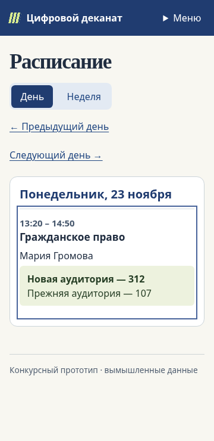
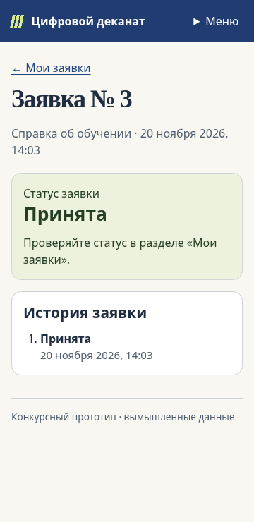
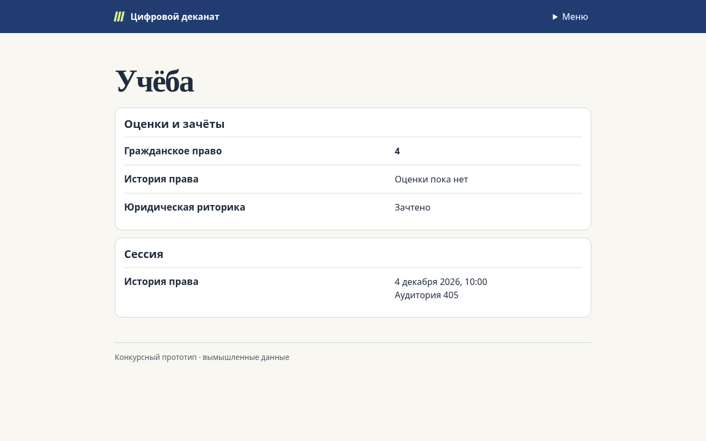
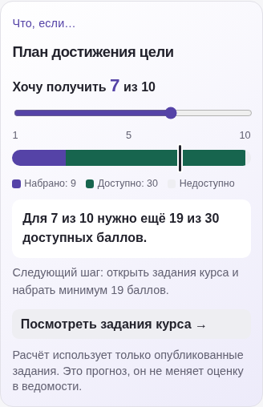

# Цифровой деканат · черновик конкурсного описания

Студент помнит аудиторию 304. Перед парой он открывает «Сегодня», видит изменение и переходит к занятию на нужную дату. Другая задача начинается с кнопки «Заказать справку» и заканчивается карточкой с номером, датой и следующим шагом. В двух вымышленных студенческих кабинетах различаются расписание группы, оценки, уведомления и заявки.

### Как менялся прототип

| Этап | Фактический результат |
|---|---|
| 00A и 00B | Появились Django-проект с входом и проверками CI и два мобильных эскиза шириной 360 px. В А сначала виден предмет, в Б — новая аудитория. Более быстрое распознавание номера в Б остаётся гипотезой. В материалах нет замеров с однокурсниками или зафиксированного выбора участников. [Эскиз А](../00B/today-a.png) · [Эскиз Б](../00B/today-b.png) |
| A1 и B1 | Сервер выдаёт отдельные профили и заявки. Интерфейс отправляет форму на сервер и сохраняет текст при ошибке. В Chromium проверили вход, создание справки, возврат к ней с главной и пустой список. [Проверка B1](../B1/check.md) |
| A2 и B2 | Уведомление и расписание ведут к одному занятию. На ширине 360 px неделя показана списком из семи дней. Успеваемость различает двойку, зачёт и отсутствие оценки. [Данные A2](../A2/README.md) · [Снимки и проверка B2](../B2/check.md) |
| Интеграция и QA | После разрешения конфликта в шаблоне «Сегодня» объединили расписание и возврат к заявке. На объединённой версии протестировали двух студентов при 360 × 740 и 1280 × 800. Прошли 16 серверных и 4 браузерных теста. QA выявила пропуск в перечне лицензий, команда дополнила документацию и перепроверила ссылки. Затем 8 из 12 пунктов приёмки были подтверждены, четыре зависели от публикации или действий капитана. [Приёмка](../QA/README.md) |
| RELEASE | В двух чистых копиях версии bd5245b повторили сборку и миграции с одной локальной постоянной БД. Новая справка сохранилась после замены приложения и перезапуска PostgreSQL. [Репетиция выпуска](check.md) |
| Доработка после публикации | В калькуляторе студент выбирает цель по шкале 1–10, видит разницу между набранными и ещё доступными баллами и может перейти к заданиям. Команда отказалась от предыдущего варианта с маршрутом дня до слияния. [Маршрут](https://github.com/roma20ix/digital-dean/pull/14) · [Калькулятор и шкала](https://github.com/roma20ix/digital-dean/pull/16) |
| Повторная приёмка, 22 ноября | В локальном Chromium вошли под двумя студентами и преподавателем на 360 и 1280 px. Устранили внутреннюю боковую прокрутку недели на 360 px и нескруглённую подсветку в посещаемости. Вернули пометку о конкурсном прототипе. Опубликованную сборку и входы с устройства в российской сети предстоит проверить отдельно. |

### Что увидит жюри

У студента Б сообщение о гражданском праве открывает карточку 23 ноября: раньше пара была в аудитории 107, теперь в 312. Старое и новое места подписаны словами. На снимке QA виден результат перехода.



Справка студента А получила номер 3 и статус «Принята». После повторного входа студент нашёл тот же номер в своих заявках. Django определяет владельца из сессии, хранит хеш пароля и проверяет владельца при открытии карточки. Токен отправки защищает от дублирования одной формы.



В кабинете Б по гражданскому праву выставлена четвёрка, по юридической риторике — зачёт, по истории права оценка ещё не выставлена. Дата и место предстоящего экзамена вынесены в раздел «Сессия».



Калькулятор показывает прогноз по опубликованным заданиям. В проверенном примере из курса «Линейная алгебра» для цели 7 из 10 нужно ещё 19 из 30 доступных баллов.



### Инструменты и их роль

| Инструмент | Пример результата |
|---|---|
| Codex, Git и GitHub | Отдельные ветки серверной и интерфейсной задач, PR с результатами проверки, разрешение конфликта главной страницы. [Исходные задания](../../../PROMPTS.md) |
| Django, Python и PostgreSQL | Сессии, связанные формы, миграции, выборка данных текущего студента и хранение заявок. SQLite использовалась для локальных тестов. |
| HTML и CSS | Автономные эскизы и адаптивные серверные страницы, собственный текстовый знак и системные шрифты. [Компоненты и лицензии](../../THIRD_PARTY.md) |
| Playwright и Chromium | Переход к карточке занятия, заполнение форм, управление клавиатурой и реальные снимки браузера. Мобильные снимки в этом документе получены при эмуляции размера экрана. |
| Gunicorn и WhiteNoise | Локальная HTTPS-приёмка приложения с раздачей собранных стилей. |
| GitHub Actions | Проверки Django в Ubuntu и Windows. [Прогон объединённой версии](https://github.com/roma20ix/digital-dean/actions/runs/44723876782) |
| Amvera | Команда вручную создала проекты приложения и базы, подключила домен и задала переменные через панель. Настройку и последующие обновления провела по шагам из диалога с Codex. [Инструкция](../../DEPLOY_AMVERA.md) |

Для финальной версии участники могут добавить собственные наблюдения с датой и условиями проверки, если они появятся. Маршрут и поля для подачи собраны в [комплекте капитана](../../SUBMISSION.md).

### Как повторить локальную приёмку

```sh
CHROMIUM_PATH=/usr/bin/chromium python manage.py test cabinet tests.ui.academic_a2 tests.ui.academic tests.ui.mobile tests.ui.learning
```

22 ноября после исправлений прошли все 34 теста. В отдельном прогоне вошли под `student_a`, `student_b` и `teacher_a` на обеих ширинах. Студент А создал справку и открыл её после обновления страницы. Студент Б получил 404 по этой же ссылке. Кабинет преподавателя не открыл ведомость студента. В локальной production-конфигурации отдельно проверили редирект на HTTPS, заголовок HSTS, Secure-флаг CSRF, сбор статики и выдачу CSS. Эти результаты относятся к локальной сборке.
